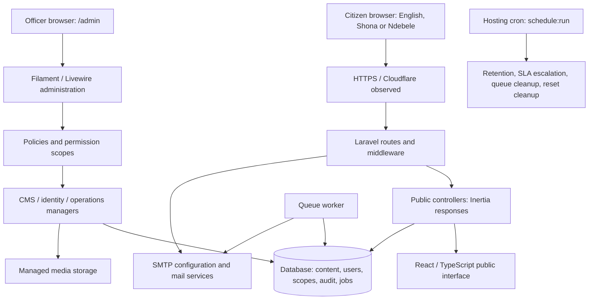
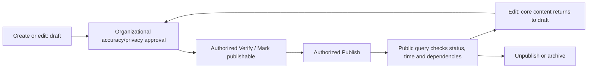
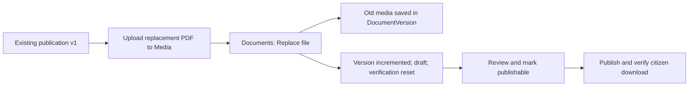
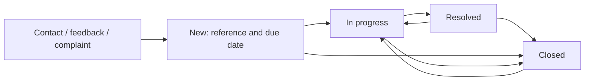

# Mutoko Rural District Council: system discovery and training readiness audit

Audit date: 12 November 2026. Audience: Council ICT personnel and training sponsors.

Status: discovery report for review. Detailed curriculum, presentation and replacement manuals have not been developed. Council approval is required before those stages, as requested in the assignment.

## 1. Evidence and scope

The audit examined the local application, installed packages, routes, registered administration modules, resource forms/actions, policies, identity and content managers, models, migrations, frontend, configuration, operational commands and existing handover materials. Repository baseline: `063d72c884099ca01524b6e20cc9e7d891e2ae0e`, with pre-existing staged and unstaged application/test changes. Findings describe the working tree; it is not a clean release artifact. Those changes were not edited.

Evidence levels used throughout:

- **Code verified:** the implementation was inspected. This does not prove production configuration or user permissions.
- **Live response verified:** a public GET returned its expected Inertia component/data. This does not prove browser rendering, accessibility, download integrity or Council approval of content.
- **Test verified:** existing automated tests ran against an isolated database and fake email.
- **Documented only:** a handover document or supplied hosting brief states it; current hosting evidence was unavailable.
- **Not verified:** evidence is missing or the relevant workflow has not been exercised.

Live checks: all **132 English URLs in the live sitemap returned HTTP 200**, with the expected public components. The sitemap contains 396 URLs across three languages. Additional checks covered `/en/about`, `/en/council/chairperson`, `/en/faqs`, `/en/search?q=budget`, `/sn`, `/nd`, `/admin/login`, `/robots.txt` and `/up`; all returned 200 through curl. Browser/search-tool and Python HTTP requests returned 403; curl succeeded. This suggests client-dependent access filtering, not a proven site outage. No bypass or production authentication was attempted.

No production records, submissions, tender-download registrations or administrative settings were created or changed. Public GETs may contribute to normal analytics. No authenticated browser walkthrough, production download submission, SMTP test, restore or deployment was performed.

Existing targeted tests: **90 tests total; 89 passed, one skipped; 585 assertions**. Files covered SecurityFoundation, EditorialWorkflow, DocumentMedia, Stage4CitizenServices, Stage4bGovernance, Stage5Participation, Stage6Localization, Stage7Monitoring, AdminProcessFlows and the Mail feature-test directory. Explicit testing overrides used SQLite `:memory:`, array cache/session/mail and synchronous queues. These results do not certify every resource or production readiness.

## 2. Verified technology stack

| Component | Observed local installed version / evidence | Qualification |
|---|---|---|
| PHP CLI | 8.3.6, `php -v` | Repository instructions say PHP 8.5; actual CLI differs. Production PHP version unverified. |
| Laravel | 13.38.0, `composer show --direct` | Composer requires `^13.17`. |
| Filament | 5.10.3 | Server-rendered administration with Livewire, not React. |
| Filament Shield | 4.3.1 | Plugin registration plus custom application policies/scopes. |
| Spatie Permission | 7.4.2 | Roles and permissions with additional `user_role_scopes`. |
| Inertia Laravel | 3.5.2 | Public controllers return Inertia responses. |
| Inertia React | 3.7.1 | Installed `node_modules` package metadata. |
| React / React DOM | 19.3.0 / 19.3.0 | TypeScript public pages. |
| Vite / Tailwind / TypeScript | 8.3.1 / 4.3.3 / 6.0.3 | Installed package metadata, not only declared ranges. |
| Pest / PHPUnit | 4.7.8 / 12.5.33 | Current targeted test run recorded above. |
| Database | MySQL and MariaDB connections supported; SQLite used for tests | Current production database engine/version not inspected. |
| Queue / session / cache | Database defaults in `config/queue.php`, `session.php`, `cache.php` | Environment can override them; Redis is also supported. |
| Localization | `en`, `sn`, `nd` | Language routing, UI strings, stored content translations, English fallback. Linguistic approval unverified. |

Composer requires PHP `^8.3` and emulates PHP 8.3.0 for dependency resolution. Do not train staff to upgrade PHP based on the instruction header alone.

## 3. Architecture Council ICT can use

This is one Laravel application with two interfaces. Citizens receive only data selected by public controllers and visibility queries. Officers use Filament resources, which apply policies and domain-manager validation. Content, media metadata, translations, revisions, versions, enquiries and audit records are stored in related database tables. Files are stored separately and served through controlled application routes.

Key source locations: `routes/web.php`, `routes/console.php`, `app/Http/Controllers/Public`, `app/Domain/{Cms,Identity,Content,Analytics,Operations}`, `app/Filament`, `app/Policies`, `app/Models`, `app/Services/{Mail,Ai}`, `resources/js/{Pages,Layouts,Components}`, `database/migrations`, `config`.

Actual panel path: **`/admin`**, login **`/admin/login`**. Local Artisan listed 152 application routes with `--except-vendor`; vendor routes such as Shield's role resource are excluded by that filter. Do not interpret their absence from that filtered list as a missing module.

Brand source: `resources/css/app.css` defines Council green `#0B8F62`, civic navy `#0B2D4D`, deep green `#075D46`, white surfaces and gold accents. Body typography uses Inter/system fallbacks; some display headings use Georgia. PublicLayout uses configured `logo_media_id`, falling back to `/images/council-crest-light.webp`. Presentation branding should use the actual approved crest, not a recreated logo; production logo selection and image quality still require visual confirmation.

## 4. Public module inventory

All main sections below have live-response evidence. Counts are a point-in-time public response snapshot, not the total internal CMS population. Paginated counts describe returned data unless explicitly labelled total.

| Public section / path after `/en` | Citizen purpose and observed response | Information origin and administration | Visibility / limitations |
|---|---|---|---|
| Home `/en` | Featured services, news, notices, publications, contacts, leadership, tenders, opportunities, projects and meetings; 3 slides and 6 statistics in response | HomeController aggregates multiple resources; Homepage slides, District statistics, Site settings and linked content | Each source has its own public query; homepage limits are not full directory counts. |
| About `/about` | Institutional information and directory links | Pages (`about-mutoko`), About.tsx, localization.ts, officials/wards/investment | Mixed CMS and code-managed content. Vision/mission render translation keys; district map is a bundled asset. Do not promise all About text is editable in Pages. |
| Mandate, organogram, legal and other `/pages/{slug}` | Managed institutional/legal text | Pages and revisions | Seven CMS page URLs in English sitemap; page publication differs from stricter document/publication controls. Content approval and last-updated display need review per page. |
| Leadership `/officials`, `/council/chairperson` | 10 official profiles; dedicated chairperson presentation | Officials; department-head flag; bundled presentation | Profiles are gated by publication. Chairperson controller contains a fallback profile path; validate its governance before teaching that every displayed name is approved CMS content. |
| Departments `/departments` | Seven public department profiles; related staff/services/documents/news/contacts | Departments plus linked modules | Internal active status and separate public publication/verification fields. |
| Wards `/wards` | 29 ward entries and detail pages | Wards: descriptions, boundary text and map URL | A ward directory does not establish authoritative GIS boundaries or an interactive GIS system. |
| Services `/services` | Nine services, requirements, procedures, fees information and enquiry links | Services; linked department documents | Informational services; external billing/payment processing not verified. |
| News `/news` | Six news entries returned | News and notices, type News | Publication/verification, time and media-status filters. Future scheduling UI not found. |
| Notices `/notices` | Four notices returned; urgent alerts shared into layout | News and notices, type Notice | Expiry is a read-time date filter; it does not necessarily update stored status. |
| Documents `/documents`, `/downloads` | Five public publications; 18 category options; search/category/year/department filters | Documents and Media; versions and download records | Only approved public records with active files qualify. Download integrity was not tested live. |
| Policies, by-laws, plans | Supported document categories | Documents | No policy/by-law category appeared in the live category-count response. Capability exists; populated approved repository not established. |
| Finance `/transparency` | Two financial publications returned, two available years | Documents; five financial categories | Live category counts identified financial reports, not approved budgets/statements/plans across all required categories. |
| Rates `/rates` | Rates page, four public bank accounts, five billing FAQs; **zero schedule documents** | Pages, Bank & Payment Accounts, FAQs, Documents | Publishes information; not an accounting ledger or verified payment gateway. |
| Procurement `/tenders` | Four tenders and detail pages; award information supported | Tenders, documents, award action, bidder relation manager, Tender compliance | Download POST collects company/email and creates bidder data. It was not submitted during audit. Procurement privacy and download visibility require focused QA. |
| Vacancies `/vacancies` | Seven vacancy entries | Vacancies, linked advert Documents | Date-based Open/Closed display; closed entries may remain publicly visible. No verified online job-application workflow. |
| Projects `/projects` | Seven projects; status/type/department/ward filters | Council projects, Project updates, wards, documents and images | Progress percentages are manually maintained, not measured automatically. |
| Meetings `/meetings` | Four meetings; agenda/minutes links supported | Council meetings and Documents | Meeting lifecycle and publication lifecycle are different fields. Attachments need public-document eligibility. |
| Investment `/investment` | 11 opportunities and detail pages | Investment opportunities; context-bearing contact links | Investor enquiries use normal enquiry workflow, not a separate investment case-management platform. |
| Tourism `/tourism` | Managed tourism page and opportunity links | Pages and Investment opportunities | CMS text plus code-defined presentation. |
| Galleries `/galleries` | Three albums and image views | Galleries, Media, captions, cover image | Active media and gallery publication control eligibility. Visual/lightbox accessibility not exercised. |
| Contact `/contact` | Public contacts and seven departments | Public contacts, Site settings, Enquiries | Form code verified; no production submission. Public contacts and global settings can supply different locations in the interface. |
| Feedback `/feedback` | Feedback/complaint form, department and ward choices | Enquiries | Private staff workflow; no public complaint listing verified. |
| FAQs `/faqs` | 11 FAQs returned | FAQs | Uses `is_published`, not general verify/publish lifecycle. |
| Languages `/en`, `/sn`, `/nd` | All three homepages responded with correct locale | UI dictionary plus polymorphic content translations | Missing content falls back to English. Route availability is not proof of complete, accurate translations. |
| Search `/search?q=budget` | Four results returned | SearchController queries eligible content | Search response verified; exhaustive relevance and privacy matrix not rerun. |
| Accessibility / mobile navigation | Skip links, focus styles, font/contrast controls, responsive styles in source | PublicLayout, AccessibilitySettings and CSS | No current manual screen-reader, keyboard or mobile-browser certification. Historic checklist leaves screen-reader review open. |
| SEO / sitemap / robots | Sitemap responded with 396 URLs; robots responded | SitemapController, Seo.tsx, public assets | Search-engine indexing, Search Console ownership and current metadata quality unverified. |
| Citizen AI assistant | Chat endpoint/widget and AI services exist in working tree | CitizenChatController; Gemini/Groq services | External-service availability, production keys, accuracy and data-governance approval unverified. Treat as optional, review required. |

Content updates depend on actual permission plus scope; a job title alone does not authorize any module. Section 6 gives the seeded role baseline.

## 5. Administration module inventory

### Interpretation

The panel registers six clusters: **Public Enquiries; Content; Council; Services & Development; Reports & Monitoring; Administration**. There are **26 application resource classes**, plus the Shield Roles resource. Pages and widgets are additional modules. The older final report's count of 23 resource areas is historical.

Tables below list practical field groups, not database-only metadata. Required fields are marked **bold** where confirmed from forms/domain validation. Most content forms additionally use **slug** (unique lowercase words with hyphens), translations, and ordering. Many managers validate title/name to 255 characters and slugs to 160; individual forms/managers remain authoritative for exceptions. Related selections are constrained again by policies/domain validation; a visible selector does not guarantee a save is authorized.

Action shorthand: C=create, E=edit, V=view record, D=delete/bulk delete where authorized. Standard lifecycle means draft save, verify/mark publishable, publish, unpublish, archive; this is not universal. Permissions use the named family plus scope, with policy exceptions below.

| Cluster / resource label or model-derived label | Form fields and dependencies | Actions, control and permission family |
|---|---|---|
| Public Enquiries / Enquiries | Read citizen identity/contact, subject/message, reference, origin, status, department, assignee and internal notes | V, D, route, assign, internal note, status/quick resolve, AI Draft Reply, Send Update to Citizen. `enquiries.view/update/route/assign/delete`; private workflow, no publication. |
| Public Enquiries / Public contacts | **office, type, value, display_order**; department | C/E/D and standard lifecycle; phone/email/address values. `contacts.*`. Feeds several public screens. |
| Public Enquiries / Incidents | **started_at, source, status**; recovered_at, summary, translations | C/E/D; recovery cannot precede start. Navigation requires `system-health.view`, query global scope, additional mutation policies apply. It is located here, not under Reports. |
| Content / Pages | **title, slug, blocks**; summary, department, SEO title/description; heading/paragraph/CTA blocks | C/E/D, preview, publish/unpublish, Mark verified/Mark publishable, archive, Restore revision, AI Translate on supported pages. `pages.*`; CTA URL must be internal. |
| Content / News and notices | **type, title, slug, body, is_urgent, display_order**; summary/category/department, image upload/library, image alt/caption, linked documents, expiry, SEO | C/E/D, preview, verify, publish, **Verify & Publish**, unpublish/archive; AI translation on supported create/edit pages. `editorial.*`. Expiry validation rejects past dates when saving. |
| Content / Media | **file on upload, title**; alt text, caption, department | C/E/D, preview, archive. `media.view/create/update/delete`. Accepted JPEG/PNG/WebP/PDF only; current default max 10,240 KB. Alt text is nullable in core upload validation. |
| Content / Documents | **title, slug, category, visibility, PDF**; description, department, reference_date | C/E/D, preview, **Replace file**, verify, publish/unpublish/archive. `documents.*` plus media access/upload permissions. Replacement preserves previous media/version and returns record to draft. |
| Content / Galleries | **title and slug**; summary/description, location/date, department, featured/order, cover image, media list/captions | C/E/D and standard lifecycle; images depend on Media. `galleries.*`. Confirm remaining field-level validation on the intended training fixture before exercises. |
| Content / Homepage slides | Headline/supporting text, CTA label/internal URL, image upload/library/alt, order, active | C/E/D, publish/unpublish; `slides.view/create/update/publish/delete`. No separate seeded `slides.verify`. |
| Content / FAQs | **question, answer, category, display_order, is_published, is_featured**; department | C/E/D; `faqs.*`. Direct published toggle; no verify action. |
| Content / Translation status (page) | Completeness for translatable models | Read completeness; access requires `pages.view`. Counts presence, not linguistic quality. |
| Council / Departments | **name, code, public_display_order**; internal description/order, public name/summary/description/responsibilities | C/E/V; verify public profile, publish/unpublish public profile, deactivate/activate. `departments.*`; internal active and public status separate. No user-style destructive delete. |
| Council / Officials | **name, title, slug**; category, department, department-head flag, order, biography, photo upload/library/alt | C/E/D, preview, standard lifecycle. `officials.*`; image references depend on Media. |
| Council / Wards | **name, slug**; description, boundaries_description, map_url, display_order | C/E/D, preview, standard lifecycle. `wards.*`. Authoritative boundary supply remains Council responsibility. |
| Council / Council meetings | **title**, meeting type, scheduled date/time, venue, meeting status, summary, department/order, agenda/minutes Documents | C/E/D, standard lifecycle. `meetings.*`; meeting status does not publish attachments. Confirm fixture-required dates/type from current form. |
| Council / District statistics | Label, value, unit, icon, source note, display_order, is_active | C/E/D, activate/deactivate. `statistics.*`; do not assume a separate publish workflow from the permission family alone. |
| Services & Development / Services | **name, slug**, summary/description, department, requirements, steps, fees information, order, SEO | C/E/D, standard lifecycle. `services.*`; fees are approved text, not billing integration. |
| Services & Development / Council projects | **title, slug**; type/status, location, department, wards, progress %, dates/order, summary/description, contact instructions, image and Documents | C/E/D, standard lifecycle; updates relation manager. `projects.*`, related-record access. |
| Services & Development / Project updates | Project, update date, title/summary, progress %, order, media | C/E/D, publish/unpublish. Uses parent project authorization; must associate update with correct project. |
| Services & Development / Investment opportunities | **title, slug**; sector, summary/description, location, opportunity status, department/order, Document | C/E/D, standard lifecycle. `investment.*`; status of opportunity differs from public publication status. |
| Services & Development / Bank & Payment Accounts | **bank name, account name/number, branch name, currency, category, display_order, status**; branch code, purpose, is_active, translations | C/E/D; `bank_accounts.*`. Direct status plus active toggle controls public visibility. No independent verification workflow. Ordinary model writes do not pass through an audited BankAccountManager. |
| Services & Development / Tenders | **reference, title, slug, description, lifecycle_status, display_order**; category, dates, instructions, department, Document | C/E/D, standard lifecycle, award action; bidder relation manager. `tenders.*` and `tenders.award`. Awarded status requires contractor and award date; amount optional/nonnegative. |
| Services & Development / Vacancies | **title, slug, description, display_order**; grade, unique optional reference, employment type, duties/requirements, dates, instructions, department, advert Document | C/E/D, standard lifecycle. `vacancies.*`; verification uses **vacancies.update**, not a separate vacancies.verify permission. Closing date must be on/after opening date when supplied. |
| Services & Development / Tender compliance (page) | Counts and overdue lifecycle reconciliation | `tenders.view`; inspect totals as operational indicators, not proof of full statutory compliance. |
| Reports & Monitoring / Audit events | Actor, action, subject, timestamp, metadata | List/V only; `audit.view`. Audit exports are separately authorized. |
| Reports & Monitoring / Error events | Error/correlation context, resolution state | List/V/resolve; inspect ErrorEventPolicy and `system-health.view` requirements. No content publication. |
| Administration / Users | **name, email**; active department, role assignment and global/department/own scope | C/E/V, disable/reactivate, assign/remove role. `users.*`. No password field exposing existing passwords; creation sends reset link. |
| Administration / Site settings | Existing setting's value or replacement logo | List/E only; `site_settings.view/update`, global query. Type-aware email/URL validation, 2,000-character value limit; no draft/publish gate. |
| Administration / Roles (Shield) | Role name, permission assignments | Plugin registered; application `RoleManager`/RolePolicy implement protected administration. `roles.*`; System Administrator role protected in custom policy. Authenticated end-to-end Shield save-path audit/escalation coverage remains unverified. |
| Administration / Email & Notifications (page) | **name, provider, host, port, encryption, from name/address**; username/password, reply-to, enabled state | Draft/test/activation-style SMTP operations; `mail_settings.view/update`. Dynamic stored configuration can override environment mail settings. Never screenshot passwords or real recipient details. |

Additional pages:

- **Dashboard:** CouncilDashboard; MyTasks widget shows assigned enquiries, pending approval and closing-soon counts. AccountWidget provides account context. TranslationCompletenessWidget supplies translation metrics where included. Visibility and metric scope must be tested with each actual training account.
- **M&E dashboard:** `analytics.view`, usage/referral/content/download indicators. Visitor counts are approximations, not unique people.
- **Monthly report:** `analytics.view`; monthly export additionally uses export authorization.
- **Audit report:** `audit.view`; audit CSV requires `audit.export`.
- **System health:** `system-health.view`; DB/Redis/table counts, with limitations in section 8.
- **Email operations:** `mail_operations.view`; retry operations require `mail_operations.retry` and may send mail. Use isolated test messages only.
- **System Walkthrough:** in-app guide at `/admin/system-guide`, with role-sensitive content; existing help must be reconciled to actual permissions.
- **Profile:** account/profile/password and recoverable authenticator-app MFA support.
- Custom login and password-reset request/reset pages are registered. No public self-registration was found in the panel registration.

### Uploads, validation and common errors

Managed upload defaults: JPEG/JPG, PNG, WebP, PDF; MIME-content and extension must agree; images must decode. The 10 MB application default can be constrained further by PHP/hosting/Livewire settings. Documents require an active PDF, while image selectors require active images. Executable/SVG uploads are not part of the allowed MediaManager list. Alt text is encouraged/flagged but is not universally mandatory in server validation.

Common causes of failure:

| Symptom | Verified control / practical first check |
|---|---|
| Menu/action missing or 403 | Active account, permission and associated scope; a role name alone is insufficient. |
| Department author cannot open Create | Several create policies call `allows(..., null, actor-id)`, so department-only scopes do not satisfy that entry check. Rehearse actual accounts before training; do not promise default scoped creation works universally. |
| Duplicate URL/reference rejected | Unique slug or reference validation; use a distinct fictional training reference. |
| Publication rejected | Required publishable state, missing/inactive media, or missing publish permission. |
| Content disappeared after edit | Most core content saves reset it to draft and clear published timestamp; re-review and publish. |
| Notice no longer visible | Expiry date or publication/media eligibility; changing stored status is not required for expiry filtering. |
| Vacancy says Closed | Date-based display, not necessarily archived content. |
| Upload rejected | True MIME/extension mismatch, invalid image, file too large, missing upload/view rights, disk permissions/space. |
| Replacement rejected | Same media selected again, inactive/non-PDF media, or missing document update/media visibility rights. |
| New user creation blocked | UserManager explicitly rejects log mail transport; secure mail/reset delivery is a prerequisite. |
| Email/AI action failed | SMTP activation/worker/provider failure, missing service configuration, quota or connectivity; do not repeatedly retry real recipient messages. |

Audit coverage is strongest in explicit domain-manager methods. Do not repeat the old claim that every administrative action is logged: generic Filament delete actions and direct model saves do not consistently call AuditWriter. No universal model observer ensuring all those writes was found. Bank-account ordinary writes are a concrete gap; translation saves may log independently. Full delete/Shield-path audit coverage needs dedicated QA.

## 6. Roles, permissions and account security

Source of truth for seed defaults: `database/seeders/SecuritySeeder.php`, not the old 96-permission document. System Administrator receives all web-guard permissions, including Shield-generated permissions; a fixed count is misleading. Production roles may have been customized and were not queried.

| Capability | System Administrator | Website Administrator | Department Content Owner | Auditor |
|---|---|---|---|---|
| Panel access | Yes, active account + valid scope | Same | Same | Same |
| Views | All seeded areas | Every explicit `.view` permission in seed list | Departments, editorial, documents, media, enquiries | Audit + analytics |
| Create/update pages, services, editorial | Yes | Yes | Editorial create/update only | No |
| Documents | Full actions | Create/update; no default verify/publish | View/create; **no default update/replace** | No |
| Media | Full actions | Create/update | View/create; no default update | No |
| Vacancies / officials / department editing | Full actions | Read only by seed default | No vacancy/official rights; department read only | No |
| Tenders / awards / bank accounts | Full actions | Read only by seed default | No | No |
| Verify / publish / delete | Applicable full permissions | Not seeded | Not seeded | No |
| User management | Full, subject to protections | View only | No | No |
| Assign roles / permissions | Custom policies require System Administrator | No | No | No |
| Audit / analytics exports | Yes | No default export rights | No | Audit export only; no default analytics export |
| SMTP configuration / email retries | Yes | View only | No | No |

`DataScopeAuthorizer` requires an active account, the permission, and a scope attached to a role that grants that permission. Scope types implemented are **global**, **department**, **own**. Global spans departments; department matches the record department; own matches the configured record owner. Policies and queries also impose module-specific checks; not every resource supports every scope equally.

Important protections in UserManager/RolePolicy: cannot disable oneself; cannot disable the last active System Administrator; cannot remove one's own System Administrator role; cannot remove the final administrator role; System Administrator assignment requires global scope; role/permission assignment requires the System Administrator role; custom RolePolicy prevents changing System Administrator permissions. Shield also configures `super_admin` gate interception and `panel_user`; these are configured plugin role names, **not evidence of seeded or assigned production roles**. Their interaction with custom controls requires a focused review before any privilege-management demonstration.

MFA: authenticator-app authentication with recovery codes is registered and supported by User. Mandatory enrollment was **not** configured in the inspected panel declaration; do not describe it as enforced for all users. Password reset pages and signed reset links exist; delivery depends on actual mail readiness. Lost-MFA recovery should use previously secured recovery codes and verified ICT identity checks; no fully verified administrative MFA-reset runbook was found. Do not invent a reset button.

Recommended mapping, subject to Council authorization: two ICT personnel need reviewed operations accounts; three HR personnel need explicitly approved vacancy/profile/content permissions; two Finance personnel need scoped document create/update/media permissions and any approved procurement rights. Job titles are not new application roles. Grant only what exercises and actual duties need, and verify authoring, review and publication separately.

## 7. Content lifecycle and governance

There are two independent dimensions: publication (`draft`, `published`, `unpublished`, `archived`) and verification (`demo`, `verified`, `publishable`). Recent migrations change verification defaults to `verified`; being verified does not mean public. Most public content additionally requires a past/current publication timestamp; documents require public visibility and active media.

The organizational approval step is recommended governance; the software stores verification actions but does not enforce an independent second officer or a signed Council approval attachment. Editorial **Verify & Publish** can combine both actions for one authorized account. Vacancy verify uses update permission. Do not teach a universal four-eyes approval mechanism.

Use Replace file for a corrected/superseding version of the same publication. Ordinary document edit accepts a media reference but does not perform the dedicated version-history operation; training must use the explicit replacement action. The reference year is derived from **reference_date**, not a separate year field or upload date.

Exceptions and constraints:

- PageManager enforces publishable status on publication in **production**, but Page::public itself checks status/time only; generic CMS page access is not uniformly filtered by verification. About/selected controllers add stricter checks. Treat this as an implementation difference requiring QA, not a universal safety guarantee.
- Standard editorial manager has no editable future publication timestamp or schedule action; publish sets timestamp to now. Date-aware queries do not establish a usable announcement-scheduling workflow.
- Notice expiry includes its closing day and hides it after expiry through public queries. It is not a scheduled archive task.
- Vacancy isOpen compares calendar dates: the vacancy stays open on its closing date, closes afterward, and can remain published as a historical entry.
- Tender display derives status from dates/lifecycle; the stored lifecycle can remain stale, which the compliance summary reports. It is not necessarily updated by a scheduler job.
- FAQs, bank accounts, site settings, slides and statistics use distinct visibility controls. Bank accounts/FAQs can become public through direct form state; settings apply on save. Standard verify/publish instructions do not apply to them.
- Page revisions support restoring a prior snapshot as draft. Document versions preserve superseded files. These are not full-system backup substitutes.
- Authorized destructive deletion exists. Prefer withdrawal/archive for retained public records. No universal recycle bin or guaranteed restoration from a deleted record was verified.
- Translation save uses update authorization and logs translations; empty translation fields fall back to English. AI Translate is an optional draft aid requiring human review, not an approval mechanism.

Enquiry routing, assignment and notes are separately permission-controlled. Default SLA is five days; scheduled overdue escalation exists. Citizen emails and AI drafting have external service/data-handling implications. AI Draft Reply stores a draft internal note; Send Update to Citizen is a separate send action. Never use a real complaint in a training AI demonstration.

## 8. ICT maintenance architecture and gaps

| Area | Verified implementation / documents | Production verification still required |
|---|---|---|
| Hosting | HTTPS and Cloudflare response headers observed. Laravel public/ web-root architecture documented. | cPanel/CloudLinux and `/home/mutokord/mutokordc-app` come from the supplied brief; not confirmed from current host configuration. |
| Runtime configuration | Database defaults for queue/cache/session; Redis options supported | Effective non-secret driver/version inventory from host. Do not distribute `.env` contents. |
| Database | Migrations include sessions/cache/jobs/failed_jobs, identity/scopes, CMS, translations, monitoring, mail configuration and tender bidders | Production engine/version, grants, migration status and capacity. |
| Storage | MediaManager uses configured `cms.media_disk`, local by default; managed files under `cms/YYYY/MM` | Actual disk/path, quota, ownership, file access, restore coverage; no blanket 777. |
| Email | Dynamic MailConfigurationService boots DB-managed configuration, refreshes before jobs, falls back to defaults on failure | Approved active SMTP, sender identity, DNS delivery records, test-safe delivery and worker execution. Some code sends mail directly; not every message is necessarily queued. |
| Queues | Database tables and retry/operations UI; workers documented | Host worker or cPanel cron mechanism, overlap prevention, retries, alerting, failed-job handling. `queue:restart` signals workers; it does not create a missing worker. |
| Scheduler | Analytics prune Sunday 02:30; enquiry escalation daily 07:00; failed-job prune monthly; password resets every 15 minutes | Host per-minute cron and actual execution history/timezone. `schedule:list` shows intended schedule, not proof it has run. |
| Health | `/up` responds; System health checks DB, Redis and jobs/failed_jobs counts | External monitor, TLS renewal monitoring, real worker/scheduler heartbeat. `/up` alone is not a complete readiness test. |
| Redis mismatch | ProductionCheck and SystemHealth always ping Redis even if all selected drivers use database | Reconcile tooling with approved hosting architecture. A Redis failure can be irrelevant to selected drivers. Do not add Redis merely to silence a false requirement. |
| Queue metrics | Health page reads database tables and calls queue Healthy unless failed count exceeds 50 | A stopped worker with pending jobs may still show Healthy; use actual process/execution evidence. |
| Backups | `backup:create` creates SQL gzip, files tar and manifest; MySQL driver only; requires mysqldump/gzip/tar; directory mode 0700 | Scheduled backup job, retention, encryption, off-server copy, integrity checks and current restoration rehearsal. No backup schedule found in routes/console.php. |
| Backup coverage | Archives storage/app excluding standard backups directory; database dump separate | Remote/custom disks are not automatically proven covered. Backup artifact is compressed, not encrypted by the command. Protect separate sealed secrets inventory. |
| Restoration | Disaster recovery document describes scratch restoration and cutover; historical 6 Oct rehearsal documented | Repeat against current schema/files on disposable infrastructure; no new rehearsal performed. Proposed RPO 24h/RTO 4 business hours are unapproved targets. |
| Logs and audit | Laravel logging, ErrorMonitor, audit records, Error events/Incidents, reports and redaction | Current rotation/retention/off-server logging, monitoring recipients, complete action audit coverage. |
| Deployment | Runbook: approved release, backup, dependencies/build, safe migrations, caches, worker restart, smoke check; rollback favors code rollback/forward fix | Exact cPanel deployment paths, PHP binary, release/asset identity, tested rollback owner. Do not execute deployment during basic staff practice. |
| TLS / DNS | HTTPS response and secure session-cookie flags observed in response headers | Certificate issuer/expiry/renewal ownership, DNS administrative ownership and origin-host controls. |
| Incidents | Incidents records, notification services and recipients config | Staffed escalation contacts, delivery test, external outage detection. An application cannot independently report every total hosting outage. |

Daily ICT priorities: public page and download availability, unresolved error events, pending/failed email/jobs, backup freshness and disk usage. Weekly: worker/cron execution evidence and account/security review. Monthly: M&E and audit review, approved dependency updates and publication freshness. Periodic: scratch restoration and access review. These are recommendations aligned with the SOP; their current execution is unverified.

## 9. Original documents and handover review

The original **`docs/ToRs for Mutoko RDC websitev2.pdf` was located and extracted/read**, including functional requirements and training clauses. Section 3.5 specifies seven staff: two ICT, three HR, two Finance. Deliverables section 5 assigns one working day in Mutoko to staff training. Those contractual constraints take priority over existing training-plan durations.

Located/reviewed core set:

- `ADMIN-USER-GUIDE.md`, `ADMIN-QUICK-REFERENCE.md`, `ICT-QUICK-REFERENCE.md`.
- `SYSTEM-ARCHITECTURE.md`, `TECHNICAL-HANDOVER.md`, `ROLE-PERMISSION-MATRIX.md`, `CONTENT-GOVERNANCE.md`.
- `DEPLOYMENT-RUNBOOK.md`, `DISASTER-RECOVERY.md`, `MAINTENANCE-SOP.md`, `OPERATIONS-CHECKLIST.md`.
- `TOR-TRACEABILITY-MATRIX.md`, `ACCEPTANCE-CHECKLIST.md`, `HANDOVER-CHECKLIST.md`, `FINAL-TECHNICAL-REPORT.md`, `PRE-PRODUCTION-BACKLOG.md`.
- Stage 3 closure and Stage 4–8 requirements/implementation/security-release records exist; they are historical evidence, not a current rerun of their test/security claims.
- `docs/architecture` includes authentication, authorization, data scopes, audit, security, deployment, development, organisation, CMS and accessibility guidance.
- Existing training directory contains TRAINING-PLAN, ICT/HR/FINANCE tracks, CYBERSECURITY, DATA-PROTECTION, TRAINING-ASSESSMENT, ATTENDANCE and FEEDBACK templates.
- Original DOCX files exist: `Mutoko_RDC_SRS.docx`, `Mutoko_RDC_SRS_React_Monolith_v1.1.docx`, `Mutoko_RDC_Production_Implementation_Plan_v1.0.docx`; text inspection identifies the original monolith/Redis design and training references. They do not establish the current cPanel runtime.

No separately named Stage 9 administrator guide is necessary to request: the existing ADMIN-USER-GUIDE and final-report references identify the handover set. Its label and historical status do not make it current. The existing traceability matrix marks broad capabilities Delivered, often with content/hosting pending; this audit uses narrower evidence-based statuses.

Material discrepancies in existing documents:

1. Role matrix says Website Administrator and Department Content Owner only have admin/department viewing; current seed grants substantially more authoring/view permissions.
2. Administrator guide says destructive deletes are disabled; current resources/policies permit many deletes.
3. Architecture/runbooks assume Redis, supervised workers and generic paths; supplied hosting brief and source defaults point toward database services on cPanel.
4. Existing training plan allocates five half-days plus a full day across sequential sessions (3.5 days), inconsistent with the contractual one day.
5. HR guide describes vacancy/profile/ward/enquiry management that the seeded Department Content Owner role does not grant.
6. Finance guide describes replacement and award workflows requiring permissions absent from default Department Content Owner.
7. Universal Draft → Verify → Publish wording ignores FAQs, settings, bank accounts and other exceptions.
8. Final report describes production deployment as pending. Public site now responds; the document is historical and cannot establish current deployment completion or acceptance.
9. Old clean-security/QA counts and 45-table restoration record should not be presented as current assurance for the November working tree.

Missing evidence, rather than missing original ToR: current host configuration/operations inventory, actual seven-user assignments, approved content/translation/branding decisions, current support contacts, current backup/restore evidence, legal/privacy approval and signed training/handover/acceptance records. Request controlled access or redacted records; never request passwords in training documents.

## 10. ToR-to-implementation and training traceability

Statuses concern the specified capability at this audit date, not contract acceptance. Verified implemented may mean code/tests plus live public response, with explicit remaining limits. No Council acceptance is inferred.

| ToR requirement | Implemented module | Verification evidence | Training topic | Responsible role | Status |
|---|---|---|---|---|---|
| 3.2.1 Homepage and featured content | Home, slides, statistics, linked resources | Live Home response; source aggregation | Homepage ownership and linked publication checks | Authorized content owner; ICT | Verified implemented |
| 3.2.2 Institutional content editable without code | Pages, About, Wards | CMS pages live; vision/mission translation keys and bundled map | Distinguish CMS edits from developer changes | Content owner; ICT | Partially implemented |
| 3.2.3 Leadership/departments | Officials, Departments | 10 officials, 7 departments live; resource/forms | Approved profiles/photos and department dependencies | HR if explicitly authorized | Verified implemented |
| Ward maps / authoritative boundaries | Ward map URLs, text, bundled district map | Source; Council-data dependency in backlog | Approved boundary sources only | Council planning/ICT | Partially implemented |
| 3.2.4 Governance repository, year, versions, replacement, downloads/filter | Documents, versions, meetings | Code/tests; 5 documents live, no policy/by-law category in snapshot | Categories, reference_date, replacement, public eligibility | Authorized departments | Partially implemented: mechanism verified; required content set absent/unverified |
| 3.2.5 Budgets, statements, reports, plans, awarded register | Financial document categories / Transparency | 2 financial reports live; 5 category capability | Approved Finance disclosure and year filters | Finance/publisher | Partially implemented: content coverage incomplete |
| 3.2.6 News/notices, urgent banner, category, expiry, SEO | Editorial | Code/tests; 10 editorial detail pages live | News vs notice, expiry and withdrawal | Authorized authors/publishers | Verified implemented |
| Future announcement scheduling | Editorial | No scheduling field/action; publish sets now | Manual authorized publication; explain limitation | Publisher / ICT | Not implemented as an administrator workflow |
| 3.2.7 Tenders, awards, compliance | Tenders, award action, compliance page | Source/tests; 4 live tenders | Dates, lifecycle reconciliation, cleared awards | Procurement-authorized officer | Verified implemented with date-derived public status |
| Stored automatic tender status update | DisplayStatus plus compliance calculations | Read-time calculation; no scheduled close task found | Difference between displayed and stored status | ICT / procurement | Partially implemented |
| Optional tender calendar | No dedicated calendar found | Route/resource review | Exclude from core practical tasks | Procurement | Not implemented in inspected workflow; optional ToR item |
| 3.2.8 Vacancies | Vacancies/Documents | Code/tests; 7 live details | Draft, edit, dates, authorized verify/publish | HR with reviewed permissions | Verified implemented |
| 3.2.9 Projects/programmes | Projects and updates | Code/tests; 7 live detail pages | Progress evidence and update publication | Authorized owner | Verified implemented |
| 3.2.10 Investment/tourism and enquiries | Opportunities, Pages, Contact context | 11 live details; tourism response; enquiry tests | Opportunity content and private routing | Authorized owner | Verified implemented; no production enquiry submitted |
| 3.2.11 Contact and Google Map integration | Public contacts/settings/contact UI | Contacts and form response; no verified Google Map integration in inspected Contact component | Contact accuracy and safe enquiry handling | Content owner / ICT | Partially implemented; map integration not verified |
| 3.2.12 Legal pages and last-updated information | CMS pages | Live CMS detail routes, Page revisions | Legal approval and currency | Designated Council owner | Partially implemented; legal approval and per-page timestamp compliance unverified |
| 3.2.13 EN/SN/ND, preference, hreflang, translations/completeness | Locale routing, dictionaries, ContentTranslation, Seo | Three homes live; source/tests | English fallback and translation review | Authorized translators / ICT | Partially implemented: tooling verified; linguistic completeness/approval unverified |
| 3.2.14 Monitoring and evaluation | Analytics, Monthly report, exports | Targeted Stage7 tests/source | Approximate metrics and monthly reporting | ICT / authorized report users | Verified implemented in code/tests; production analytics accuracy unverified |
| 3.2.15 All administrative actions audited | AuditWriter, events/reports | Explicit manager audit; generic delete/direct saves lack universal hook | Audit scope, accountability and gaps | ICT / auditor | Partially implemented |
| 3.2.16 Uptime/errors/monthly/downtime alerts | Health, errors, incidents, alert services | Source/tests; /up live | Worker/cron/monitor evidence and escalation | ICT / hosting | Partially implemented: external monitoring/delivery unverified |
| 3.3 Security, HTTPS, authentication/session | Policies, middleware, MFA, reset | HTTPS/header evidence, source and targeted security tests | Accounts, phishing, least privilege, recovery | All; ICT administration | Partially implemented as assurance: full current security assessment not performed |
| Zimbabwe data-protection compliance | Consent/privacy content and access controls | Source/document review only | Privacy, publication minimization, incident escalation | All / designated Council privacy lead | Not verified as legal compliance; requires current legal review |
| 3.3.1 WCAG 2.1 AA and mandatory alt text | Controls and semantic/responsive source | Alt text nullable in MediaManager; historical manual QA outstanding | Alt descriptions, keyboard and accessible documents | All / ICT QA | Partially implemented; full conformance not verified |
| 3.3.2–3 SEO/indexing | Seo, sitemap, robots | 396-URL sitemap and robots responded | Metadata accuracy and post-publication checks | Content / ICT | Partially implemented; indexing/ownership unverified |
| 3.4 Deployment, backups, DR | Deployment/backup tooling and runbooks | Public responses; command inspection; historical rehearsal | Backup verification, scratch restore, safe release/rollback | ICT / hosting | Partially implemented: current operational evidence missing |
| 3.5 Four mandatory subjects for 7 staff, one working day in Mutoko | Existing Stage9-style Markdown material | Original ToR §§3.5/5; multi-day existing plan | CMS, basic admin, security/privacy, maintenance | 2 ICT / 3 HR / 2 Finance | Partially implemented: material exists; one-day revision and delivery pending |
| Attendance, competence, acceptance and handover | Blank registers/checklists | Existing templates and unchecked handover checklist | Assessment and ownership transfer | Facilitator / Council sponsor | Not verified; no results or acceptance fabricated |

This is a training-focused traceability map of the ToR requirements inspected. Full contractual sign-off requires the Council to review source evidence and outstanding content/hosting/legal dependencies; a public 200 response alone is not acceptance.

## 11. Training needs and priorities for seven participants

### All seven

Prioritize navigation, login/recovery, own permissions, public/private content, draft versus publishable versus published, dates, safe PDF/image uploads, reference dates, citizen-side verification, phishing, account sharing prevention, personal-information minimization and incident escalation. Explain that CMS visibility does not confer permission and that an approval from a manager is not automatically a system publish action.

Use fictional material visibly marked TRAINING in a disposable environment. Disable external email or use a controlled sink; do not call external AI services with complaints/personnel data. No production training records. Public GET walkthroughs are safe, but public forms/download registrations can create real data and must be avoided during demonstrations.

### ICT personnel (2)

Highest priorities: establish actual host inventory, approve/test role scopes, account activation/recovery/MFA, demonstrate audit limits, distinguish queue depth from worker health, verify cron execution and SMTP operations, inspect backup completeness/off-server retention, explain scratch restoration and escalation. Advanced deployment and full restoration are demonstrations/runbook exercises within one day, not a promise of independent infrastructure mastery after one session.

### HR personnel (3)

Highest priorities: vacancy draft/edit/opening/closing dates, advert dependencies, authorizing publication, approved profile/privacy decisions and citizen-view check. Current default Department Content Owner does not allow these vacancy tasks; training access must be prepared and rehearsed before assessment. Do not make ward administration mandatory for HR without Council responsibility assignment.

### Finance personnel (2)

Highest priorities: approved PDF classification, reference_date/year, confidentiality, public/private visibility, Replace file with preserved history, re-review/republication and download checks. Use only fictional budget PDFs in training. Procurement/award actions and bank-account changes need explicit business authorization; do not infer them from Finance employment. Bank details deserve separate checked approval because direct status changes can publish them.

### One-day feasibility

08:30–16:30 provides 480 minutes; the proposed 15-minute tea and 45-minute lunch leave 420 minutes including registration, assessment and handover. Keep shared foundational demonstrations short, use the HR/Finance period for role-relevant guided practice, and let ICT observe publication dependencies while retaining its own operations exercises. Reserve the proposed 45-minute practical assessment and 30-minute evaluation/handover. Detailed timing, objectives and materials will be developed only after approval.

The proposed 70% threshold is a Council decision, not a completed standard or participant result. Include critical privacy/production-safety checkpoints separately from the aggregate score. No participant has yet been assessed in this audit.

## 12. Readiness decisions and limitations

Before a reliable hands-on session, obtain or confirm:

1. Approved isolated training environment with sanitized/disposable data, test PDFs/images, mail sink and known public preview address.
2. Seven named participant assignments and tested least-privilege training accounts, including the create-policy/scope issue. Do not solve it by giving all seven System Administrator.
3. Actual host inventory: PHP binary/version, database engine/version, selected drivers, application path, queue execution method, cron, file disk, backup target and support owners. The supplied cPanel path is unverified, not rejected.
4. Approved author/reviewer/publisher responsibilities and retention/deletion rules. Confirm whether bank-account changes are within the training's authorized scope.
5. Approved Council content, crest and translation/legal/privacy wording; a comprehensive multilingual completeness and manual accessibility check remains outstanding.
6. Test-safe evidence of SMTP delivery, backup freshness, an off-server copy, current restoration and external monitoring. Historic reports cannot substitute.
7. Authenticated screenshots and browser walkthroughs from the intended training build, checked against each role. No administration screenshots were fabricated or captured from unrelated dashboards.

Application issues to triage separately from training preparation: department-only create-policy entry checks; inconsistent publication verification gates; announcement scheduling absence; nullable mandatory-alt requirement; generic delete/direct-write audit gaps; Redis-only readiness assumptions; queue health that does not establish worker progress; procurement download endpoint's weaker document eligibility checks versus Document::public; Shield super-admin/custom policy interactions. These are findings for focused QA, not claims of proven exploitability or permission to change application behavior.

Legal instruction must be refreshed from authoritative Zimbabwe legislation/regulator guidance when developing the cybersecurity/data-protection session. This report does not give legal advice or certify statutory compliance.

## 13. Discovery QA and next gate

Completed: installed stack verified, architecture mapped, all English sitemap public responses checked, three language home responses checked, all 26 application resources and panel pages/widgets inventoried, seeded roles and lifecycle exceptions inspected, targeted isolated tests run, original ToR read, existing handover/training conflicts recorded, one-day priorities identified. No application code was changed for this audit.

Incomplete verification: authenticated browser/role walkthroughs, visual/mobile/screen-reader testing, full SN/ND page review and linguistic approval, live attachment integrity, actual production permissions, all administrative audit-path coverage, origin-host/backup/cron/SMTP/worker evidence, current restore and complete legal/security certification. These limits must remain visible in subsequent material.

**Approval requested:** approve this discovery baseline and authorize development of the detailed one-day curriculum and website-specific presentation/supporting package, retaining these limitations and resolving exercise-critical access/staging dependencies before finalizing screenshots and practical assessments. Approval to develop training does not authorize production writes, deployments or role changes.
